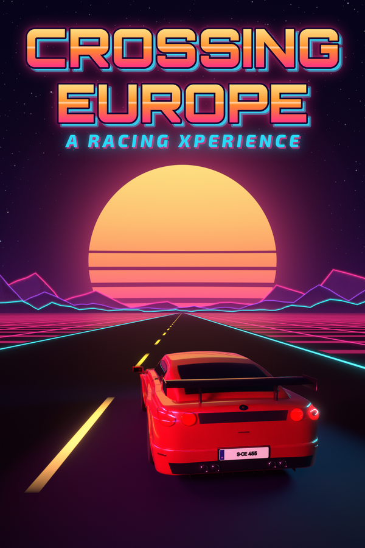
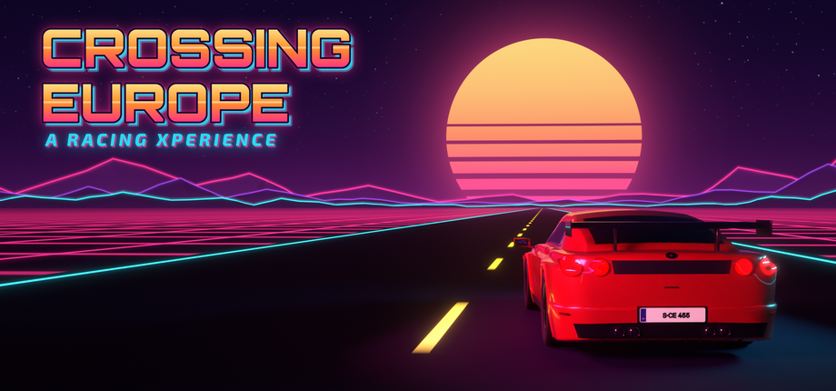

# Crossing Europe – A Racing Xperience

Arcade-Racer in Pseudo-3D: Etappenrennen quer durch Europa auf Bestzeit – mit Verkehr in Fahrtrichtung,
Nachtankzwang, Radarfallen und Polizei, Tageszeit und Wetter. Vorbilder: *Enduro* (Atari VCS) und
*The Great American Cross-Country Road Race* (Activision).

- Design: [docs/Design-Dokument.md](docs/Design-Dokument.md)
- Technik: [ARCHITECTURE.md](ARCHITECTURE.md) und die Moduldokus in [docs/](docs/)
- Engine: Godot 4.7.2 (GDScript, Renderer „GL Compatibility“), alle Fahrzeuge, Bäume, Gebäude, Tankstellen und
  Symbole prozedural in Blender 5.2 modelliert und als Sprites gerendert
- Stand: **v0.6.0 – Gamepad und Steam Deck**; alle acht Schritte des Prototyp-Plans sind umgesetzt, alle Zahlen sind
  Startwerte zum Testen.

## Neu in v0.7.0

Aus dem Spieltest von v0.6.0: „Die Etappen sind ein wenig kurz“, im Rennen 8 statt 12 Stunden Pause, der Tank geht in
die nächste Etappe mit, und zwei neue Rennen – Wien – Hamburg und Bukarest – Calais.

- **Längere Etappen**: Zeitraffer 10 statt 12 – jede Etappe dauert ein Fünftel länger (1 Stunde Weltzeit = 6 statt
  5 Spielminuten), eine mittlere Etappe für einen guten Fahrer rund 9 statt 7½ Minuten. Kilometer, Radarfallen und
  City Limits bleiben, wo sie sind (sie dauern nur länger); die Straße selbst ist neu erzeugt, mit einem Fünftel mehr
  Kurven und Hügeln je Etappe ([docs/Design-Dokument.md](docs/Design-Dokument.md) „Zeit und Strecke“).
- **8 Stunden Pause** zwischen den Etappen eines Rennens statt 12: Die Startzeit wandert in etwa zweieinhalb Etappen
  einmal um die Uhr – Morgen, Nachmittag, Nacht … –, statt nur zwischen zwei Tageszeiten hin und her zu springen
  (Kiel – Nürnberg ab 8 Uhr: Etappen gegen 8, 17, 2, 11 und 21 Uhr).
- **Tank im Rennen**: Was im Ziel einer Etappe im Tank ist, geht in die nächste Etappe mit (auch über die Fähre); die
  erste Tankstelle liegt dafür in jeder Fahrtrichtung spätestens 20 km nach dem Start (meist nach 12 km; Tankstellen
  gibt es jetzt je Fahrtrichtung, alle 60–90 km wie bisher). Reicht der Tank nicht einmal mit 60 km/h bis dorthin,
  kommt vor dem Start der Abschleppdienst (1:30, halber Tank). Etappenbildschirm und Countdown zeigen den Tank, die
  erste Tankstelle und ob es reicht („reicht auch mit Vollgas“ / „höchstens … km/h“). Wer an der letzten Tankstelle
  einer Etappe volltankt, kommt in jedem Auto mit Vollgas bis zur ersten der nächsten. Einzelne Etappen starten wie
  bisher mit eigener Füllung ([docs/gameplay.md](docs/gameplay.md) „Tank im Rennen“).
- **Zwei neue Rennen**: **Wien – Hamburg** genau wie gewünscht über Linz, Passau, Regensburg, Nürnberg, Fulda, Kassel
  und Hannover (8 Etappen, 1.150 km, jede Stadt ein Etappenziel) und **Bukarest – Calais** quer durch Europa (rund
  2.500 km: durch das Olttal über die Karpaten nach Sibiu, über Timișoara, Budapest und Wien, ab Wien an der Donau
  entlang oder über Prag nach Nürnberg, dann über Frankfurt, Köln und Brüssel an den Ärmelkanal). Neu sind Rumänien
  mit eigener Polizei und zehn Städte mit eigenen Wahrzeichen (Kölner Dom, Regensburger und Passauer Dom, Mariendom
  Linz, Parlamentspalast Bukarest, Atomium, Leuchtturm von Calais …); die Europakarte reicht jetzt bis Bukarest
  ([docs/daten.md](docs/daten.md), [docs/staedte.md](docs/staedte.md)).
- **So lange dauern die Rennen jetzt** – der vorsichtige Autopilot (Limousine, Start 8 Uhr, Wetter des Rennens):
  Kiel – Nürnberg 38:14 über Kassel bzw. 44:20 über Frankfurt (v0.6.0: 27:51), München – Bremen 35:48, Wien – Hamburg
  56:01, Bukarest – Calais 1:56:37 über Linz, das Königsrennen im Kombi 6:48:35. Die Rekorde der Starteinträge in den
  Bestenlisten (gute Fahrer): Kiel – Nürnberg 31:04, Wien – Hamburg 48:47, Bukarest – Calais 1:40:04, Königsrennen
  5:52:36.
- **Bestenlisten umgerechnet**: Etappenzeiten gelten mit dem neuen Zeitraffer – gleicher Schnitt, Zeit × 1,2, Namen
  und Reihenfolge bleiben, die Starteinträge sind neu berechnet. Die Rennlisten beginnen neu (Zeitraffer, Pause und
  Tank-Übernahme ändern die Rennzeiten); die alte Datei bleibt als `leaderboards.json.v06` neben den Bestenlisten
  erhalten. Ein laufendes Rennen wird beim Fortsetzen ebenso umgerechnet und startet seine nächste Etappe einmal mit
  vollem Tank ([docs/daten.md](docs/daten.md)).
- Polizei: Eine Verfolgung endet spätestens nach 72 statt 60 Sekunden – so reicht sie wie bisher bis zu 42 km weit
  und kann in die City Limits hineinlaufen.
- Warnschild vor blinden Kurven kurz vor dem Ziel: Lag die Mitte des Kurvenstücks hinter der Ziellinie, fehlte es
  (mit dem neuen Zeitraffer 150 m vor dem Ziel in Würzburg aufgefallen, [docs/renn-modul.md](docs/renn-modul.md) §4).
- Demo-Szenen auf die neue Straße eingestellt (Paris, Wien, Regen, Feierabendverkehr), Tutorial: die Tankstelle kommt
  nach 15 km, der Hinweis auf den knappen Tank kommt gleich nach dem Start.

## Neu in v0.6.0

- **Gamepad und Steam Deck geprüft und verbessert** ([docs/steam-deck.md](docs/steam-deck.md), „Prüfung v0.5.1“):
  - Ein Stick-Stoß verstellt Fahrzeug, Startzeit und Optionen nur noch um einen Schritt (vorher mehrere).
  - Jedes angeschlossene Gamepad fährt und bedient die Menüs, nicht mehr nur das erste – auch der externe Controller
    am angedockten Steam Deck. Gelenkt wird mit dem Stick des zuletzt benutzten Pads; ein herumliegendes Pad mit
    driftendem Stick lenkt nicht mit, und schaltet es sich ab, pausiert das Rennen nicht.
  - Gehaltenes Steuerkreuz oder gehaltener Stick laufen durch Listen, LB/RB (Bild ↑/↓) blättern seitenweise.
  - Die Bildschirmtastatur löscht mit B nur noch ein Zeichen, schließt im leeren Feld, Start = Fertig; mit der
    Tastatur (auch der Steam-Tastatur) lässt sich direkt ins Namensfeld tippen.
  - Lenken mit dem Stick: kleinere Totzone, volle Lenkung schon vor dem Anschlag.
  - **Vibration** bei Unfällen, an der Leitplanke, auf dem Bankett und beim Untersteuern (Optionen, abschaltbar); auf
    dem Steam Deck über dessen Haptik.
  - Die Straße läuft auch bei 40, 45 und 90 Bildern pro Sekunde gleichmäßig (Steam Deck OLED, Akku-Sparen), und es
    gibt keine Nachladeruckler mehr bei Gebäuden, Lkw und Wahrzeichen: Alles für die Etappe wird vor dem Start
    geladen („Etappe wird geladen …“).
  - Das Rennen pausiert auch bei Fokusverlust im Countdown, nach dem Standby und wenn das benutzte Pad sich trennt.
  - Pause-Taste im Countdown genannt, Gas-Symbol im Tankfenster, Abfrage vor dem Beenden, Tastenhinweise in jeder
    Abfrage; Pausenmenü und Spiel ohne Fokus laufen mit 30 Bildern pro Sekunde (Akku); nach 10 Minuten ohne Eingabe
    keine Demos mehr.
  - Vollbild: Wer in v0.5.x „Vollbild: Aus“ gewählt hatte und auf einem Bildschirm bis 800 px Höhe spielt (Steam
    Deck, kleine Laptops), startet einmal im Vollbild und stellt es bei Bedarf noch einmal aus.
- **Lichter verdeckter Fahrzeuge scheinen nicht mehr durch**: Der Blinker eines Autos hinter einer Kuppe leuchtete
  durch die Fahrbahn (Spieltest) – ebenso Rück-, Brems- und Blaulichter hinter Kuppen und Lkw, Laternen hinter Häusern
  und Bäumen und Tunnellampen hinter der Tunnelwand. Ein Licht leuchtet jetzt nur noch dort, wo seine Quelle zu sehen
  ist; sichtbare Lichter sehen aus wie bisher, auch der Lichthof des Autos direkt vor dir über dem eigenen Dach
  ([docs/renn-modul.md](docs/renn-modul.md), §2 „Lichter und Verdeckung“).
- **Design-Dokument** an v0.5.0 angepasst: Verkehr, Wetter und Fahrverhalten, City Limits, Tutorial
  ([docs/Design-Dokument.md](docs/Design-Dokument.md), Änderungen markiert mit *(seit v0.5.0)*).

## Neu in v0.5.0

- **Verkehr als echtes Hindernis**: Lkw fahren auf der Autobahn 80–90 km/h, Busse 95–100, Pkw richten sich nach dem
  Tempolimit. Lkw überholen Lkw („Elefantenrennen“) und machen zwei Spuren dicht, langsame Fahrzeuge ziehen Kolonnen
  hinter sich her, und niemand macht mehr Platz: Autos ziehen mit Blinker vor dir heraus – 1–1,5 s vorher angekündigt
  und nie so knapp, dass Bremsen nicht mehr reicht. An Spurenden fädelt der Verkehr im Reißverschluss ein. Nachts gibt
  es keinen Tempobonus mehr, dafür weniger Verkehr ([docs/gameplay.md](docs/gameplay.md), „Schwierigkeit (v0.5.0)“).
- **Regen und Schnee mit Folgen**: Die Haftung (Regen 0,75, Schnee 0,45) wirkt auf Kurven, Bremsen, Beschleunigen und
  Lenken. Im Schnee ist der Bremsweg doppelt so lang, 0–100 km/h dauert mit jedem Auto etwa 8,4 s (Limousine trocken
  5,6 s), und nach einem Spurwechsel rutscht der Wagen weiter – Gegenlenken nötig. Der Verkehr fährt bei Regen 15 %, bei Schnee 35 % langsamer, du kommst
  also viel schneller auf ihn zu. Ein Hinweis im Countdown sagt, worauf es ankommt; City Limits werden 4 km vorher
  angekündigt, das Warnschild „Kuppe“ steht vor blinden Kuppen. Die Tutorial-Etappe Kiel – Hamburg bleibt immer trocken
  und erklärt jetzt auch Blinker und Elefantenrennen.
- **Neuer Titelbildschirm**: Sonnenuntergang über der Autobahn vor der Frankfurter Skyline mit langsamer Kamerafahrt,
  das Menü auf einer Milchglas-Karte.
- **Attract-Modus**: Nach einer Minute ohne Eingabe im Titel startet eine 30-Sekunden-Demo, jedes Mal eine andere
  Szene – Feierabendverkehr vor Frankfurt, Schneetreiben in den Pyrenäen, Ankunft in Paris, über die Köhlbrandbrücke
  nach Hamburg, Nachtfahrt im Regen nach Berlin, über die Lagune nach Venedig, Morgendämmerung in Wien. Die
  Titelmelodie läuft weiter, die Effekte sind stumm, jede Taste führt zurück zum Titel, gespeichert wird nichts.
- **Neue Titelmelodie**: Synthwave-Rock mit 128 bpm, 3:22 min, mit Gitarrensolo und einem Schlussrefrain einen Ton
  höher; das Intro läuft einmal, danach wiederholt sich das Stück nahtlos ([docs/ui.md](docs/ui.md), „Titelmelodie“).
- **Windows-Version** für Windows 10/11 (64 Bit), wie unter Linux eine einzige Datei ohne Installation
  ([docs/windows.md](docs/windows.md)). Die Release-Archive enthalten alle Lizenzhinweise in `LIZENZEN.txt`.
- **Bestenlisten**: Die Starteinträge richten sich nach der Etappe (Stadtanteil, Pflicht-Tankstopp, Fähren) – auf
  Kiel – Hamburg sind sie jetzt erreichbar. Gespeicherte Listen bleiben, wie sie sind.
- **Behoben**: Wer an der Leitplanke zum Stehen kam (vor allem im Schnee), kam nicht mehr los.

## Neu in v0.4.0

- **Individuelle Städte**: 21 Baustile mit eigenem Stadtrand und Zentrum – z. B. kleine Einfamilienhäuser mit
  Lattenzaun und Garten am Stadtrand in Osteuropa, Plattenbauten, Grachtenhäuser in Amsterdam, Haussmann-Blöcke in
  Paris, Palais und Zinshäuser in Wien, Speicherstadt und Kontorhäuser in Hamburg, Fachwerk, Berner Lauben. 21
  Wahrzeichen (Eiffelturm, Elbphilharmonie, Michel, Riesenrad, Stephansdom, Fernsehturm, Frauenkirchen Dresden und
  München, Sagrada Família, Mailänder Dom, Campanile, Parlament Budapest, Veitsdom, Kulturpalast Warschau,
  Alexander-Newski-Kathedrale u. a.), schon ab den City Limits als Silhouette am Horizont. **Brücken mit Wasser**:
  Hamburg über Köhlbrandbrücke und Elbbrücken, Amsterdam über Grachten mit Hausbooten, Venedig über den Lagunendamm,
  Flussbrücken in Paris, Prag, Wien, Budapest und vielen weiteren Städten ([docs/staedte.md](docs/staedte.md)).
- **Verkehr hörbar**: Fahrzeuge in der Nähe klingen räumlich (Motor, Reifen, Fahrtwind), mit Doppler-Effekt beim
  Überholen; Lkw tief und laut, Martinshorn kommt von der Polizei; Hall im Tunnel, eigener Motor breiter im
  Stereobild ([docs/verkehrsgeraeusche.md](docs/verkehrsgeraeusche.md)).
- **Fahrphysik**: Wer zu schnell in die Kurve fährt, wird deutlich nach außen gedrückt; die Agilität entscheidet über
  das Kurventempo. Warnschilder und Richtungstafeln an scharfen Kurven, Leitplankentreffer kosten Tempo und sind zu
  hören; die Polizei bremst in Kurven ebenfalls ([docs/gameplay.md](docs/gameplay.md)).

## Neu in v0.3.0

- **Eigener Motor für jedes Auto**: Kompakt mit 2,0-l-Vierzylinder-Turbo, Kombi mit Turbodiesel, Limousine mit
  Reihensechszylinder, Sportwagen mit hochdrehendem Sechszylinder-Boxer, Gran Turismo mit V8-Biturbo. Der Klang
  entsteht aus einem physikalisch angelehnten Modell (Auspuffstöße in echter Zündfolge, Auspuffanlage, Ansaug- und
  Mechanikgeräusche, Diesel-Nageln) und wird im Spiel Arbeitsspiel für Arbeitsspiel passend zur Drehzahl
  zusammengesetzt.
- **Getriebe je Auto**: lastabhängiges Hochschalten, Rückschalten beim Bremsen (bei den sportlichen Autos mit
  Zwischengas), Begrenzer, Gasstöße im Countdown, Turbopfeifen, Schubumluftzischen und Knallen im Schub, Anlassen.
- **Probehören**: in der Fahrzeugwahl gibt jedes Auto beim Wechsel einen kurzen Gasstoß.
- **Steam Deck**: Menüs füllen den 16:10-Bildschirm, bei Gamepad-Bedienung nur Gamepad-Symbole, größere und
  kontrastreichere Schrift im HUD, Namenseingabe in den Optionen per Bildschirmtastatur.

## Neu in v0.2.0

- **Einlenken ohne Sprünge**: Pkw und Polizei vor dir drehen sich in 17 Stufen (3°-Schritte) gleichmäßig in die Kurve.
  Der Darstellungswinkel berücksichtigt die Fahrzeuglänge, die Front liegt also dort, wo die Perspektive sie zeigt –
  kein Auto scheint mehr über mehrere Spuren zu ragen, und was du siehst, ist genau das, womit du kollidierst.
  Autos direkt neben dir (beim Überholen) werden streifenweise perspektivisch gezeichnet und scheinen nicht mehr in
  deine Spur zu ziehen.
- **Lkw und Busse als echte Quader**: Sie werden perspektivisch aus texturierten Flächen gezeichnet, biegen sich
  abschnittsweise mit der Kurve und bleiben beim Überholen neben dir vollständig sichtbar.
- **Neue Spielerautos**: fünf glatte, detailreiche Modelle (Felgen, Leuchtengrafiken, Diffusor, Spiegel, Kennzeichen),
  gerendert mit der Spielkamera in 21 Winkeln. Das eigene Auto folgt sichtbar der Kurve, dreht beim Spurwechsel ein
  und neigt sich leicht in der Kurve.
- Verkehrs- und Polizeiautos neu gerendert; Fahrzeugtexturen VRAM-komprimiert.

## Spielen

Linux (x86_64): `CrossingEurope.x86_64` ausführbar machen und starten – eine einzige Datei, keine Installation nötig
(OpenGL 3.3). Selbst bauen: `tools/build_linux.sh` (Godot 4.7.2 mit Export-Templates). Am besten mit dem Rennen Kiel – Nürnberg beginnen: Die erste
Etappe Kiel – Hamburg ist das Tutorial.

```bash
chmod +x CrossingEurope.x86_64
```

```bash
./CrossingEurope.x86_64
```

Windows 10/11 (64 Bit): `CrossingEurope-windows-x86_64.zip` entpacken und `CrossingEurope.exe` starten – ebenfalls eine
einzige Datei ohne Installation. Die Datei ist nicht signiert, beim ersten Start warnt deshalb Windows SmartScreen:
„Weitere Informationen“ → „Trotzdem ausführen“. Browser-Warnungen, intelligente App-Steuerung, Virenscanner,
Grafikprobleme, Spielstände, Prüfsummen, Selbstbauen (`tools/build_windows.sh`, ein Release für beide Plattformen mit
`tools/build_release.sh <Version>`) und was geprüft ist: [docs/windows.md](docs/windows.md).

| Aktion | Tastatur | Gamepad |
|---|---|---|
| Lenken | ← → oder A D | linker Stick / Steuerkreuz |
| Gas | ↑ oder W | rechter Trigger / A |
| Bremse | ↓ oder S | linker Trigger / X |
| Pause | Esc oder P | Start (Steam Deck: ≡) |
| Menü: wählen / bestätigen / zurück | Pfeiltasten / Enter / Esc | Steuerkreuz oder Stick (gehalten: läuft weiter) / A / B |
| Menü: lange Listen seitenweise | Bild ↑ / Bild ↓ | LB / RB |

Jedes angeschlossene Gamepad funktioniert (auch ein zweites oder der externe Controller am angedockten Steam Deck).
Optionen → „Vibration“ schaltet das Rumpeln bei Unfällen, an der Leitplanke, auf dem Bankett und beim Untersteuern
an oder aus.

## Steam Deck

Läuft als Nicht-Steam-Spiel auf dem Steam Deck und ist komplett mit dem eingebauten Controller spielbar: Die
Tastenhinweise zeigen dort nur Gamepad-Tasten, Namen gibt man über eine Bildschirmtastatur ein, die Menüs füllen den
16:10-Bildschirm, die Vibration gibt Steam Input an die Haptik des Decks weiter. Prüfungen (v0.3.0 und v0.5.1),
Messwerte und empfohlene Einstellungen (Vorlage „Gamepad“, Vollbild, kein Proton, Bildrate 60 oder für mehr Akku
40/45/30): [docs/steam-deck.md](docs/steam-deck.md).

## Steam-Artwork

Wer das Spiel als Nicht-Steam-Spiel in Steam einbindet (Linux, Windows, Steam Deck): fertige Bibliotheksbilder im
Look des Titelbildschirms liegen in [marketing/steam/](marketing/steam/) – Grid hochkant (600×900) und quer
(920×430), Hero-Banner, transparentes Logo und Icon, jeweils auch in doppelter Auflösung. Die Anleitung zum
Einrichten steht in [marketing/steam/README.md](marketing/steam/README.md).

 

## Was drin ist

- **Pseudo-3D** aus kurzen Segmenten (Node2D mit `_draw`), Kurven, Hügel mit Kuppen, Tunnel mit Lichterreihen,
  Grenzübergänge mit EU-Schild, Zollhäuschen, neuer Landschaft und landestypischer Polizei.
- **Zeitraffer 10** *(seit v0.7.0, vorher 12)*: Die Straße scrollt mit Tachotempo, Kilometerzähler und Uhr laufen
  zehnmal schneller (100 km bei 100 km/h = 6:00 min).
- **Fünf Fahrzeuge** (Kompakt, Kombi, Limousine, Sportwagen, Gran Turismo) mit den Werten aus dem Design-Dokument;
  Arcade-Fahrmodell ohne Übersteuern; wer zu schnell in die Kurve fährt, untersteuert deutlich: der Wagen rutscht nach
  außen, Gegenlenken hilft nur bei knapp zu hohem Tempo, Bremsen vor der Kurve ist die Abhilfe. Die Agilität bestimmt das
  Kurventempo: in den schärferen Autobahnkurven muss jedes Auto vom Gas, der Gran Turismo schon in den mittleren;
  Warnschilder und rot-weiße Richtungstafeln kündigen scharfe und hinter Kuppen versteckte Kurven an, das Warnschild
  „Kuppe“ blinde Kuppen, hinter denen langsamer Verkehr stehen kann.
- **Verkehr** nur in Fahrtrichtung mit Tageskurve, Lkw rechts und im Elefantenrennen, Kolonnen, Spurwechseln mit Blinker
  und Reißverschluss an Spurenden; Kollisionen nach den Regeln
  des Dokuments (3 s auf 10 km/h, seitlich schieben, blinken, Ein-Drittel-Regel für Überholer von hinten).
- **Tanken**: Verbrauch 14 + 0,00034·v², Tankstellen alle 60–90 km mit Ankündigung 30/15/5 km, Tankspur,
  „Volltanken? – Gas = Weiterfahren“, Abschleppdienst bei leerem Tank. Seit v0.7.0 je Fahrtrichtung die erste
  Tankstelle spätestens 20 km nach dem Start; im Rennen geht der Tank in die nächste Etappe mit (reicht er nicht
  einmal mit 60 km/h bis zur ersten Tankstelle, kommt vor dem Start der Abschleppdienst).
- **Radar und Polizei**: Warnung 10 km vorher, 5-km-Feld, 15 % Toleranz, Verfolgung mit Flucht ab 220 km/h – in
  Kurven muss auch die Polizei bremsen, dort reicht weniger –, „Führerschein, bitte!“; City Limits in den letzten 20 km
  jeder Etappe.
- **Tageszeit und Wetter**: frei wählbare Startzeit, nächste Etappe 8 h Weltzeit nach dem Ende der vorigen (die
  Startzeit wandert über die Etappen um die Uhr), Dämmerung/Nacht/Sonnenaufgang während der Fahrt, Regen und Schnee.
- **Streckennetz** komplett in Datendateien: 55 Städte, 64 Etappen (in beide Richtungen fahrbar), Fähre
  Riga – Rostock, sechs Rennen: Kiel – Nürnberg (Route über Kassel oder über Frankfurt), Dresden – Dortmund,
  München – Bremen, Wien – Hamburg (über Linz, Passau, Regensburg, Nürnberg, Fulda, Kassel und Hannover, 1.150 km
  in 8 Etappen), Bukarest – Calais (rund 2.500 km in 11–13 Etappen, ab Wien an der Donau entlang oder über Prag)
  und das Königsrennen (rund 9.200 km in 33 Etappen plus Fähre).
- **Etappenbildschirm** mit Karte (Natural Earth), Wetter, Tank, Rekord-Laufschrift und Top 10; Bestenlisten pro Etappe
  und Rennen mit Fahrzeug, Wetter- und Tageszeit-Symbol; Namenseingabe auch per Gamepad; Spielstand nach jeder Etappe.
- **Sound** komplett prozedural: fünf eigene Motoren aus einem physikalisch angelehnten Modell mit Getriebe je Auto
  ([docs/motorsound.md](docs/motorsound.md)), Wind, Martinshorn, Blitzer, Tanken; Titelmelodie (Synthwave-Rock, offline
  synthetisiert mit `tools/audio/music_synth.py`).
- **Titelbildschirm** mit Titelbild und Attract-Modus (Demo nach einer Minute ohne Eingabe, [docs/ui.md](docs/ui.md)).

## Entscheidungen zu den offenen Punkten

Alle Werte stehen in `config/game_config.json` und lassen sich ohne Neubau ändern (siehe unten).

| Offener Punkt | Umsetzung (Startwert) |
|---|---|
| Fahrzeugtypen | Werte wie vorgeschlagen; Beschleunigung als Zeiten 0–100/0–200 je Stufe, Agilität als Lenk- und Kurvengriff |
| Bestenlisten gemeinsam oder getrennt? | beides: gespeichert je Fahrzeugtyp, angezeigt gemeinsam mit umschaltbarem Fahrzeugfilter |
| Wetter im Rennen | zufällig, gewichtet nach Klima der Region (alternativ `random` oder fest pro Etappe); die Tutorial-Etappe Kiel – Hamburg ist immer trocken |
| Tempo-Abzug Regen / Schnee / Nacht | −2,5 % / −12 % / −1 %; Regen + Nacht erlaubt jedem Auto noch 220 km/h |
| Zeitraffer und Pause (seit v0.7.0, Spieltest v0.6.0: „Etappen ein wenig kurz“) | Faktor 10 (ursprünglich 12): 1 Stunde Weltzeit = 6 Spielminuten, Etappen ein Fünftel länger; 8 h Pause zwischen den Etappen eines Rennens (ursprünglich 12 h) |
| Verkehr (seit v0.5.0, Spieltest v0.4.0: „zu leicht“) | Lkw 80–90 km/h, Busse 95–100 km/h (ursprünglich alle 110–150), kein Nachtbonus (ursprünglich +15 %), bei Regen 15 %, bei Schnee 35 % langsamer |
| Zeitstrafe leerer Tank | 90 s Abschleppdienst, danach halber Tank |
| Straßenrand | Bankett bremst auf 90 km/h; Autobahn mit Leitplanke (abprallen), sonst Wiese (bremst auf 40 km/h) |
| Plattform und Eingabe | Linux x86_64 und Windows 10/11 x86_64, Tastatur und Gamepad |
| Sound, Musik, Sprache | prozeduraler Sound, Titelmelodie (offline synthetisiert), alle Texte deutsch über `tr()` (übersetzbar) |

## Werte und Strecken anpassen ohne Neubau

- `game_config.json` **neben der ausführbaren Datei** überschreibt einzelne Werte der zentralen Konfiguration:

  ```json
  { "fuel": { "tow_penalty_s": 120 }, "traffic": { "chase_density_factor": 0.3 } }
  ```

  Ein Gamepad, dessen Stick in Ruhe driftet (das Auto zieht ohne Eingabe zur Seite): `{ "input": { "stick_deadzone":
  0.2 } }`; Stärke der Vibration: `{ "input": { "vibration": { "scale": 0.5 } } }`.

- Ein `network.json` neben der ausführbaren Datei (oder in einem Ordner `data/` daneben) ersetzt das eingebaute
  Streckennetz – neue Städte, Etappen und Rennen ohne Codeänderung (Format: [ARCHITECTURE.md](ARCHITECTURE.md) §4).

## Entwicklung

```bash
tools/run_tests.sh
```

```bash
tools/build_linux.sh
```

- `tools/run_tests.sh [filter]` – kompiliert alle Skripte und startet die Headless-Tests.
- `tools/screenshot.sh <präfix> --stage=dev_testetappe --start-km=48 --hour=21 --autopilot --shot-times=2,4`
- `godot --headless --path . -s res://tests/race/run_race.gd -- --race=kiel_nuernberg --autopilot --no-countdown`
  fährt ein ganzes Rennen mit dem Autopiloten durch den echten Menüablauf.
- `tools/blender/render_all.py` rendert alle Sprites neu (Blender 5.2 als Python-Modul `bpy`),
  `tools/map/` erzeugt Karte und Streckennetz.

## Lizenzen der Fremddaten

Engine: Godot Engine (MIT-Lizenz, <https://godotengine.org/license>) samt ihren Bestandteilen von Dritten.
Schriften: Orbitron, Exo 2, Barlow Condensed, Share Tech Mono (SIL Open Font License, siehe `assets/fonts/`).
Kartendaten: Natural Earth (gemeinfrei) über das npm-Paket `world-atlas` (ISC, `data/map/LICENSE-world-atlas.txt`).
Die Release-Archive enthalten alle Lizenzhinweise in `LIZENZEN.txt` (erzeugt von `tools/write_licenses.gd`).
