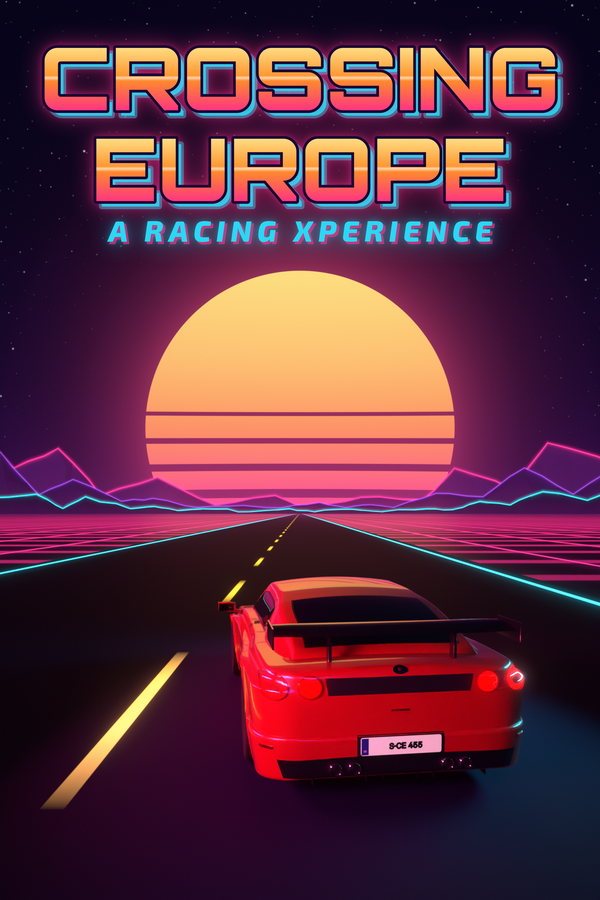
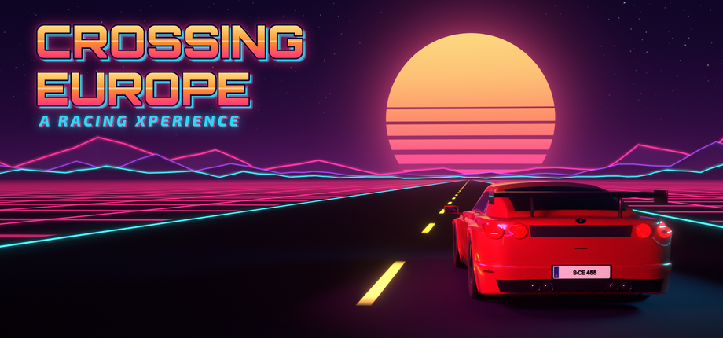

# Crossing Europe – A Racing Xperience

Arcade-Racer in Pseudo-3D: Etappenrennen quer durch Europa auf Bestzeit – mit Verkehr in Fahrtrichtung,
Nachtankzwang, Radarfallen und Polizei, Tageszeit und Wetter. Vorbilder: *Enduro* (Atari VCS) und
*The Great American Cross-Country Road Race* (Activision).

- Design: [docs/Design-Dokument.md](docs/Design-Dokument.md)
- Technik: [ARCHITECTURE.md](ARCHITECTURE.md) und die Moduldokus in [docs/](docs/)
- Engine: Godot 4.7.2 (GDScript, Renderer „GL Compatibility“), alle Fahrzeuge, Bäume, Gebäude, Tankstellen und
  Symbole prozedural in Blender 5.2 modelliert und als Sprites gerendert
- Stand: **v0.3.0 – Motorklang v2 und Steam Deck**; alle acht Schritte des Prototyp-Plans sind umgesetzt, alle
  Zahlen sind Startwerte zum Testen.

## Neu in v0.3.0

- **Eigener Motor für jedes Auto**: Kompakt mit 2,0-l-Vierzylinder-Turbo, Kombi mit Turbodiesel, Limousine mit
  Reihensechszylinder, Sportwagen mit hochdrehendem Sechszylinder-Boxer, Gran Turismo mit V8-Biturbo. Der Klang
  entsteht aus einem physikalisch angelehnten Modell (Auspuffstöße in echter Zündfolge, Auspuffanlage, Ansaug- und
  Mechanikgeräusche, Diesel-Nageln) und wird im Spiel Arbeitsspiel für Arbeitsspiel passend zur Drehzahl
  zusammengesetzt.
- **Getriebe je Auto**: lastabhängiges Hochschalten, Rückschalten beim Bremsen (bei den sportlichen Autos mit
  Zwischengas), Begrenzer, Gasstöße im Countdown, Turbopfeifen, Schubumluftzischen und Knallen im Schub, Anlassen.
- **Probehören**: in der Fahrzeugwahl gibt jedes Auto beim Wechsel einen kurzen Gasstoß.
- **Steam Deck**: Menüs füllen den 16:10-Bildschirm, bei Gamepad-Bedienung nur Gamepad-Symbole, größere und
  kontrastreichere Schrift im HUD, Namenseingabe in den Optionen per Bildschirmtastatur.

## Neu in v0.2.0

- **Einlenken ohne Sprünge**: Pkw und Polizei vor dir drehen sich in 17 Stufen (3°-Schritte) gleichmäßig in die Kurve.
  Der Darstellungswinkel berücksichtigt die Fahrzeuglänge, die Front liegt also dort, wo die Perspektive sie zeigt –
  kein Auto scheint mehr über mehrere Spuren zu ragen, und was du siehst, ist genau das, womit du kollidierst.
  Autos direkt neben dir (beim Überholen) werden streifenweise perspektivisch gezeichnet und scheinen nicht mehr in
  deine Spur zu ziehen.
- **Lkw und Busse als echte Quader**: Sie werden perspektivisch aus texturierten Flächen gezeichnet, biegen sich
  abschnittsweise mit der Kurve und bleiben beim Überholen neben dir vollständig sichtbar.
- **Neue Spielerautos**: fünf glatte, detailreiche Modelle (Felgen, Leuchtengrafiken, Diffusor, Spiegel, Kennzeichen),
  gerendert mit der Spielkamera in 21 Winkeln. Das eigene Auto folgt sichtbar der Kurve, dreht beim Spurwechsel ein
  und neigt sich leicht in der Kurve.
- Verkehrs- und Polizeiautos neu gerendert; Fahrzeugtexturen VRAM-komprimiert.

## Spielen

Linux (x86_64): `CrossingEurope.x86_64` ausführbar machen und starten – eine einzige Datei, keine Installation nötig
(OpenGL 3.3). Selbst bauen: `tools/build_linux.sh` (Godot 4.7.2 mit Export-Templates). Am besten mit dem Rennen Kiel – Nürnberg beginnen: Die erste
Etappe Kiel – Hamburg ist das Tutorial.

```bash
chmod +x CrossingEurope.x86_64
```

```bash
./CrossingEurope.x86_64
```

| Aktion | Tastatur | Gamepad |
|---|---|---|
| Lenken | ← → oder A D | linker Stick / Steuerkreuz |
| Gas | ↑ oder W | rechter Trigger / A |
| Bremse | ↓ oder S | linker Trigger / X |
| Pause | Esc oder P | Start |
| Menü: wählen / bestätigen / zurück | Pfeiltasten / Enter / Esc | Stick / A / B |

## Steam Deck

Läuft als Nicht-Steam-Spiel auf dem Steam Deck und ist komplett mit dem eingebauten Controller spielbar: Die
Tastenhinweise zeigen dort nur Gamepad-Tasten, Namen gibt man über eine Bildschirmtastatur ein, die Menüs füllen den
16:10-Bildschirm. Prüfung, Messwerte und empfohlene Einstellungen (Vorlage „Gamepad“, Vollbild, kein Proton):
[docs/steam-deck.md](docs/steam-deck.md).

## Steam-Artwork

Wer das Spiel als Nicht-Steam-Spiel in Steam einbindet (Linux, Steam Deck): fertige Bibliotheksbilder im Look des
Titelbildschirms liegen in [marketing/steam/](marketing/steam/) – Grid hochkant (600×900) und quer (920×430),
Hero-Banner, transparentes Logo und Icon, jeweils auch in doppelter Auflösung. Die Anleitung zum Einrichten steht in
[marketing/steam/README.md](marketing/steam/README.md).

 

## Was drin ist

- **Pseudo-3D** aus kurzen Segmenten (Node2D mit `_draw`), Kurven, Hügel mit Kuppen, Tunnel mit Lichterreihen,
  Grenzübergänge mit EU-Schild, Zollhäuschen, neuer Landschaft und landestypischer Polizei.
- **Zeitraffer 12**: Die Straße scrollt mit Tachotempo, Kilometerzähler und Uhr laufen zwölfmal schneller
  (100 km bei 100 km/h = 5:00 min).
- **Fünf Fahrzeuge** (Kompakt, Kombi, Limousine, Sportwagen, Gran Turismo) mit den Werten aus dem Design-Dokument;
  Arcade-Fahrmodell ohne Übersteuern, Untersteuern bei zu hohem Kurventempo.
- **Verkehr** nur in Fahrtrichtung mit Tageskurve, Nachtbonus, Lkw rechts, Spurwechseln; Kollisionen nach den Regeln
  des Dokuments (3 s auf 10 km/h, seitlich schieben, blinken, Ein-Drittel-Regel für Überholer von hinten).
- **Tanken**: Verbrauch 14 + 0,00034·v², Tankstellen alle 60–90 km mit Ankündigung 30/15/5 km, Tankspur,
  „Volltanken? – Gas = Weiterfahren“, Abschleppdienst bei leerem Tank.
- **Radar und Polizei**: Warnung 10 km vorher, 5-km-Feld, 15 % Toleranz, Verfolgung mit Flucht ab 220 km/h,
  „Führerschein, bitte!“; City Limits in den letzten 20 km jeder Etappe.
- **Tageszeit und Wetter**: frei wählbare Startzeit, nächste Etappe 12 h Weltzeit nach dem Ende der vorigen,
  Dämmerung/Nacht/Sonnenaufgang während der Fahrt, Regen und Schnee.
- **Streckennetz** komplett in Datendateien: 45 Städte, 51 Etappen (in beide Richtungen fahrbar), Fähre
  Riga – Rostock, vier Rennen: Kiel – Nürnberg (Route über Kassel oder über Frankfurt), Dresden – Dortmund,
  München – Bremen und das Königsrennen (rund 9.200 km in 33 Etappen plus Fähre).
- **Etappenbildschirm** mit Karte (Natural Earth), Wetter, Rekord-Laufschrift und Top 10; Bestenlisten pro Etappe
  und Rennen mit Fahrzeug, Wetter- und Tageszeit-Symbol; Namenseingabe auch per Gamepad; Spielstand nach jeder Etappe.
- **Sound** komplett prozedural: fünf eigene Motoren aus einem physikalisch angelehnten Modell mit Getriebe je Auto
  ([docs/motorsound.md](docs/motorsound.md)), Wind, Martinshorn, Blitzer, Tanken, Menümusik.

## Entscheidungen zu den offenen Punkten

Alle Werte stehen in `config/game_config.json` und lassen sich ohne Neubau ändern (siehe unten).

| Offener Punkt | Umsetzung (Startwert) |
|---|---|
| Fahrzeugtypen | Werte wie vorgeschlagen; Beschleunigung als Zeiten 0–100/0–200 je Stufe, Agilität als Lenk- und Kurvengriff |
| Bestenlisten gemeinsam oder getrennt? | beides: gespeichert je Fahrzeugtyp, angezeigt gemeinsam mit umschaltbarem Fahrzeugfilter |
| Wetter im Rennen | zufällig, gewichtet nach Klima der Region (alternativ `random` oder fest pro Etappe) |
| Tempo-Abzug Regen / Schnee / Nacht | −2,5 % / −12 % / −1 %; Regen + Nacht erlaubt jedem Auto noch 220 km/h |
| Zeitstrafe leerer Tank | 90 s Abschleppdienst, danach halber Tank |
| Straßenrand | Bankett bremst auf 90 km/h; Autobahn mit Leitplanke (abprallen), sonst Wiese (bremst auf 40 km/h) |
| Plattform und Eingabe | Linux x86_64, Tastatur und Gamepad |
| Sound, Musik, Sprache | prozeduraler Sound, Menümusik, alle Texte deutsch über `tr()` (übersetzbar) |

## Werte und Strecken anpassen ohne Neubau

- `game_config.json` **neben der ausführbaren Datei** überschreibt einzelne Werte der zentralen Konfiguration:

  ```json
  { "fuel": { "tow_penalty_s": 120 }, "traffic": { "chase_density_factor": 0.3 } }
  ```

- Ein `network.json` neben der ausführbaren Datei (oder in einem Ordner `data/` daneben) ersetzt das eingebaute
  Streckennetz – neue Städte, Etappen und Rennen ohne Codeänderung (Format: [ARCHITECTURE.md](ARCHITECTURE.md) §4).

## Entwicklung

```bash
tools/run_tests.sh
```

```bash
tools/build_linux.sh
```

- `tools/run_tests.sh [filter]` – kompiliert alle Skripte und startet die Headless-Tests.
- `tools/screenshot.sh <präfix> --stage=dev_testetappe --start-km=48 --hour=21 --autopilot --shot-times=2,4`
- `godot --headless --path . -s res://tests/race/run_race.gd -- --race=kiel_nuernberg --autopilot --no-countdown`
  fährt ein ganzes Rennen mit dem Autopiloten durch den echten Menüablauf.
- `tools/blender/render_all.py` rendert alle Sprites neu (Blender 5.2 als Python-Modul `bpy`),
  `tools/map/` erzeugt Karte und Streckennetz.

## Lizenzen der Fremddaten

Schriften: Orbitron, Exo 2, Barlow Condensed, Share Tech Mono (SIL Open Font License, siehe `assets/fonts/`).
Kartendaten: Natural Earth (gemeinfrei) über das npm-Paket `world-atlas` (ISC).
